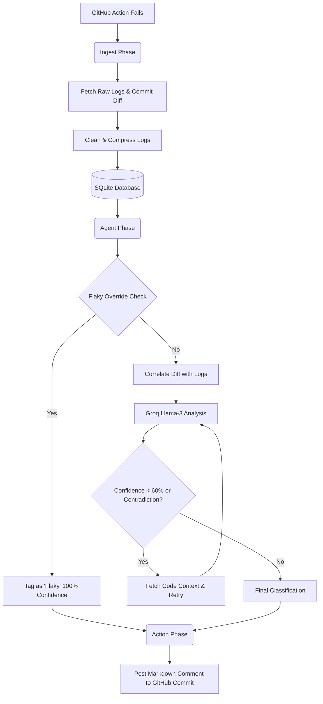

# Autonomous CI Triage Agent

An autonomous AI agent that automatically investigates failing GitHub Actions workflows, categorizes the root cause, and posts a triage report directly to the triggering commit.

Built with Python, SQLite, and the Groq API (Llama-3.3-70B).

---

## 🧠 Why this exists
In large repositories, developers waste countless hours digging through thousands of lines of CI logs just to figure out if a failure was a genuine regression or a flaky network timeout. 

This agent automates that manual toil. It doesn't just pass logs to an LLM blindly; it uses a hybrid approach of **deterministic heuristics** (commit diff analysis) and **semantic log analysis** (LLM reasoning), wrapped in a retry loop to catch hallucinations.

## 🏗️ Architecture Flow



## 📊 Evaluation & Benchmarking
Unlike most AI side-projects, this agent is rigorously benchmarked against a custom evaluation dataset of 20 unique CI failure scenarios. 

**Current Accuracy: 65.0%**

| Category | Precision / Recall | Notes |
| :--- | :--- | :--- |
| **Environment** | 100% | Flawlessly detects pip dependency errors. |
| **Flaky** | 100% | Flawlessly detects timing/async timeouts. |
| **Infra** | 100% | Accurately identifies YAML/runner misconfigurations. |
| **Lint/Syntax** | 100% | Accurately catches code formatting violations. |
| **Regression** | **Low** | The pipeline struggled here due to **Heuristic Anchoring**. |

**Engineering Takeaway (Heuristic Anchoring):** 
During evaluation, I discovered that if the agent's deterministic prompt hint strongly suggested that a run *might* be Flaky (due to a lack of relevant code diffs), the LLM would over-anchor on that hint and completely ignore the obvious `AssertionError` in the logs. To push this past 70% in production, the semantic log analysis and the commit-diff heuristics must be isolated into separate decision-tree layers rather than injected simultaneously into a single LLM call.

## ⚙️ Quickstart

### 1. Setup Environment
```bash
git clone https://github.com/your-username/ci-triage-agent.git
cd ci-triage-agent
python -m venv .venv
source .venv/bin/activate  # Or .\.venv\Scripts\activate on Windows
pip install -r requirements.txt
```

### 2. Configure API Keys
Copy the example environment file and add your tokens:
```bash
cp .env.example .env
```
Ensure you provide a **GitHub Personal Access Token** (with `repo` access) and a **Groq API Key**.

### 3. Run the Agent
The agent is split into two modular CLI commands:

**Step 1: Ingest the Failure**
```bash
python run_ingest.py https://github.com/<owner>/<repo>/actions/runs/<run_id>
```

**Step 2: Classify and Notify**
```bash
python run_classify.py <run_id> <repo>
```
*Once classification finishes, the agent will automatically post the result to the relevant GitHub commit.*

## 🗂️ Taxonomy
The agent strictly categorizes failures into one of five buckets:
1. **Regression**: Logic errors causing test assertion failures.
2. **Flaky**: Non-deterministic failures (timing, race conditions, external network timeouts).
3. **Environment**: Missing dependencies or python version mismatches (`ModuleNotFoundError`).
4. **Infra**: GitHub Actions runner misconfigurations or secret permission errors.
5. **Lint/Syntax**: Pre-execution compilation or formatting errors (e.g., `flake8`, missing colons).
